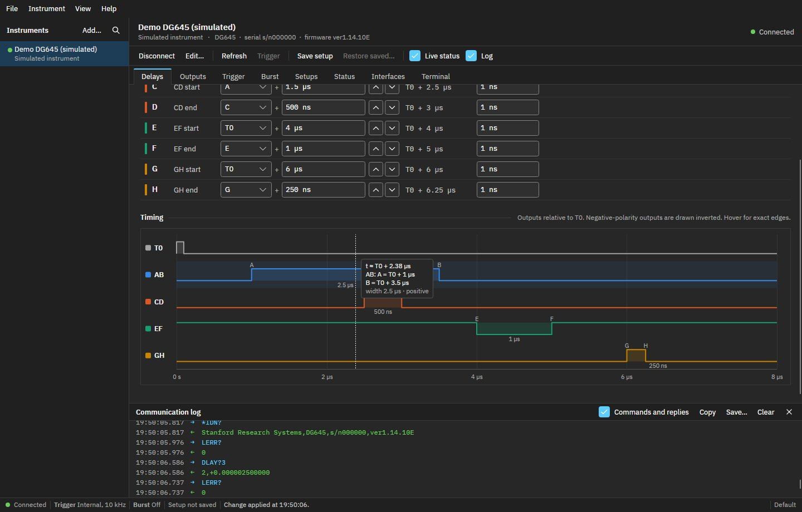
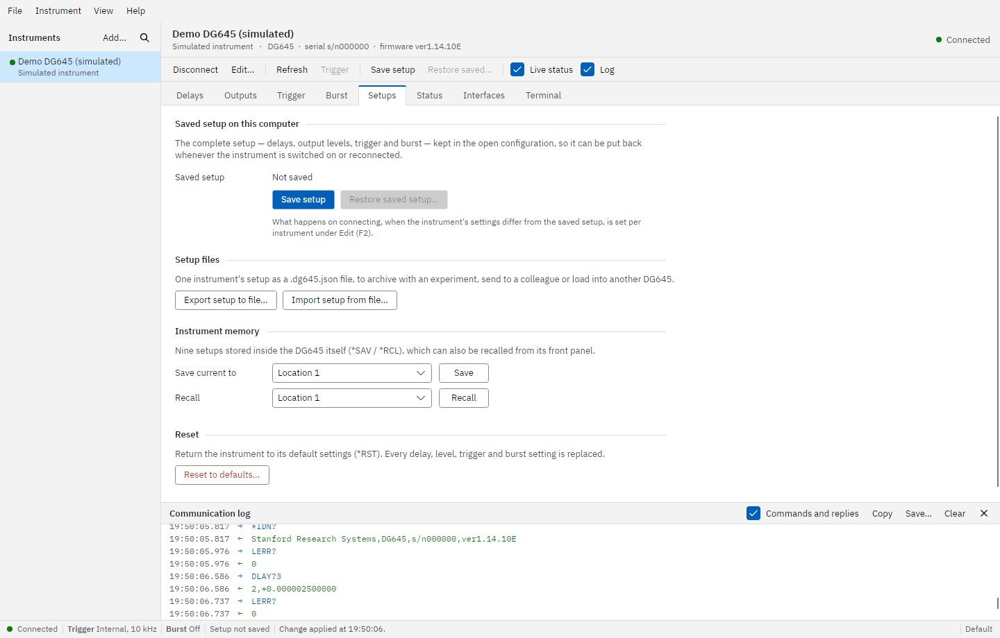
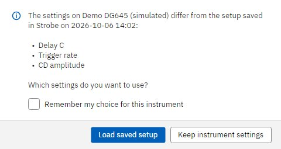
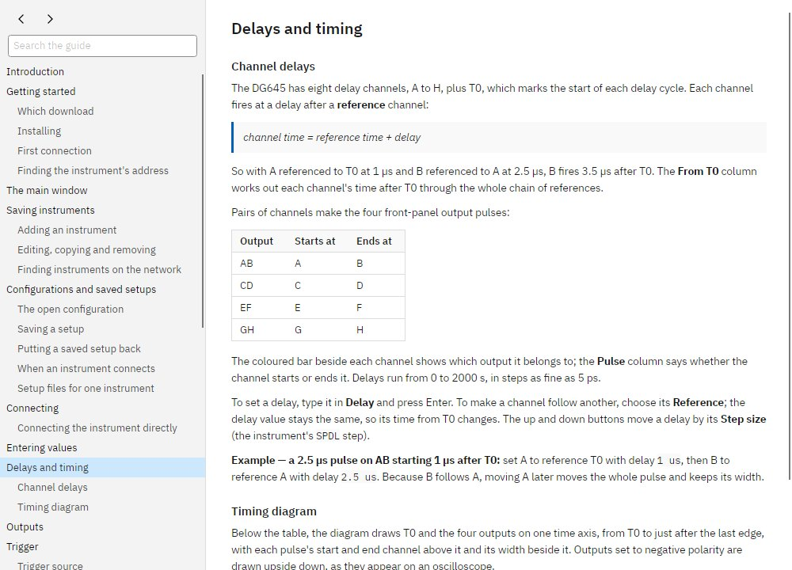

# Strobe

Desktop software for controlling **Stanford Research Systems DG645 digital delay generators** over
Ethernet, for Windows 10/11 and Linux (Debian, Ubuntu, Arch and other x86-64 distributions).

Save each instrument once under a name you choose ("Laser lab DG645", "Beamline trigger") and pick it
from a list, with no IP addresses to remember. Every setting the DG645 exposes over its remote
interface is on one of eight pages, and complete setups are kept in configuration files on your
computer, so the system can be put back exactly as it was whenever it is switched on.

*Strobe* is an anagram of *sorbet*, which has nothing to do with delay generators.


## Download

Get the program from the [latest release](../../releases/latest):

| File | For |
| --- | --- |
| **`Strobe.exe`** | Windows 10 and 11. Keeps its files in `%APPDATA%\Strobe`. |
| **`Strobe-Portable.exe`** | Windows, run from a USB stick or shared folder. Keeps everything in a `Strobe-data` folder beside it. |
| **`strobe_<version>_amd64.deb`** | Debian and Ubuntu: `sudo apt install ./strobe_<version>_amd64.deb` |
| **`PKGBUILD`** | Arch Linux: put it in an empty folder and run `makepkg -si`. |
| **`Strobe-<version>-linux-x64.tar.gz`** | Any x86-64 Linux desktop: unpack, then `./install.sh` (or just run `./strobe`). |
| `Strobe-linux-x64`, `Strobe-Portable-linux-x64` | The bare Linux program, normal and portable (`chmod +x` after downloading). |

Each program is a single self-contained file: the .NET runtime, the Avalonia user interface, the
renderer and the fonts are all inside, so there is nothing else to install. Windows SmartScreen may ask
for confirmation the first time because the program is not code-signed (**More info ▸ Run anyway**).

A new release is built automatically every time `main` changes (see
[How releases are made](#how-releases-are-made)).

## Features

* **Saved instruments.** Name, IP address or host name, port, timeout, location and notes. Add, edit,
  duplicate, reorder and remove; test the connection before saving.
* **Configurations and saved setups.** A configuration file (`*.strobe`) holds your instruments and,
  for each, its complete setup: delays, references, output levels, trigger, prescalers and burst.
  **Ctrl+S** saves the setup of every connected instrument; **Restore** puts a setup back. Open, save as
  and switch between configurations, one per experiment or lab; the last one reopens at startup.
* **Setup check on connect.** When an instrument with a saved setup connects, Strobe compares the two
  and, if they differ, lists what differs and asks whether to keep the instrument's settings or load
  the saved setup. The answer can be remembered per instrument, so a system can come up fully
  configured on its own.
* **Find instruments on the network**, or check a single address, and add one with a click.
* **Delays.** Channels A–H with reference channel and delay, step buttons, time from T0, and a timing
  diagram of the AB, CD, EF and GH pulses with widths and a hover read-out of exact edge times.
  Values take units: `1.5 us`, `250 ns`, `2 ms`, `1e-6`.
* **Outputs.** Amplitude, offset and polarity for T0, AB, CD, EF and GH in one table, with TTL and NIM
  presets and the resulting idle and pulse levels.
* **Trigger and burst.** Source, rate, threshold, inhibit, single-shot trigger, advanced triggering,
  holdoff, prescalers and phases; burst count, period, delay and T0 behaviour.
* **Setups page.** Saved setup, `.dg645.json` setup files, the instrument's nine memory locations, and
  reset.
* **Status, interfaces and terminal.** Live status registers with enable masks, error list, self test,
  auto calibration and timebase; every LAN, RS-232 and GPIB setting; a command terminal with history,
  error checking and a searchable command reference.
* **Communication log** of every command and reply, which can be copied or saved.
* **Built-in user guide**: F1 opens it at the page you are on.
* **Demo instrument**: a simulated DG645 for trying everything without hardware.
* **Light, dark or system theme**, meeting WCAG AA contrast, with output colours validated to stay
  distinguishable with colour blindness. Every value written is read back, so the screen always shows
  what the instrument accepted.

## Screenshots

Rendered by the CI smoke test against the built-in simulated DG645.



| | |
| --- | --- |
|  |  |
| Output levels with TTL and NIM presets | Saved setup, setup files and instrument memory |
|  |  |
| The question asked when an instrument differs from its saved setup | The built-in user guide |

## Documentation

* [`docs/USER-GUIDE.md`](docs/USER-GUIDE.md): the user guide, also built into the program (F1).
* [`docs/DG645-Command-Reference.md`](docs/DG645-Command-Reference.md): the DG645 remote command set,
  parameters, status registers and error codes, and where each command appears in the program.
* [`docs/manuals/`](docs/manuals/README.md): the official Stanford Research Systems manual and data
  sheet. If the PDFs are not there yet, run the **Fetch DG645 manuals** workflow from the Actions tab
  (or `scripts\Download-Manuals.ps1`).

> **Model number.** Stanford Research Systems' Ethernet-controlled delay generator is the **DG645**
> (there is no "DG465"). The older DG535 has no Ethernet interface.

## Building from source

Requirements: the [.NET 10 SDK](https://dotnet.microsoft.com/download), on Windows, Linux or macOS.

```sh
dotnet test                                    # unit, simulator and user-guide tests
dotnet run --project src/StanfordController.App
dotnet publish src/StanfordController.App -c Release -r win-x64   -o publish/win     # publish/win/Strobe.exe
dotnet publish src/StanfordController.App -c Release -r linux-x64 -o publish/linux   # publish/linux/Strobe
# add -p:PortableBuild=true for the portable variant
packaging/linux/build-packages.sh <version> publish/linux/Strobe dist    # .tar.gz, .deb and PKGBUILD
```

`Strobe --smoke-test <folder> [--headless]` runs the real program against the simulated instrument,
visits every page and dialog in both themes and at the minimum window size, saves a setup to a
configuration, writes screenshots to the folder, and exits with a non-zero code on any exception or
binding error. CI runs it on Windows and on Linux (under a virtual X display).

### Project layout

| Path | Contents |
| --- | --- |
| `src/StanfordController.Core` | DG645 protocol: TCP transport, typed client for every command, settings snapshots and comparison, simulator, configuration files, network discovery. |
| `src/StanfordController.Presentation` | View models for every page and dialog, the user-guide reader, data folders and preferences; no UI framework dependency, fully unit-tested. |
| `src/StanfordController.App` | The Avalonia desktop application (builds `Strobe`): windows, pages, styles, timing diagram, help window, smoke test. |
| `tests/StanfordController.Tests` | Unit tests, simulator tests, real-socket tests and checks of the user guide. |
| `packaging/` | Linux desktop entry, install script, Debian package and Arch PKGBUILD builders. |
| `docs/` | User guide, command reference and official documents. |
| `.github/workflows/` | CI/release and manual-download workflows. |

## How releases are made

[`.github/workflows/build-and-release.yml`](.github/workflows/build-and-release.yml) runs for every push
and pull request, on Windows and on Linux: it builds, runs the tests, publishes the normal and portable
single-file programs, runs the UI smoke test on each, and on Linux builds the `.deb`, tarball and
`PKGBUILD`. The programs are attached to each run as artifacts.

On every push to **`main`** it also creates a GitHub Release named `v1.0.<run number>` with all of the
files above and a `SHA256SUMS.txt`. The newest Windows program is always at
`releases/latest/download/Strobe.exe`.
