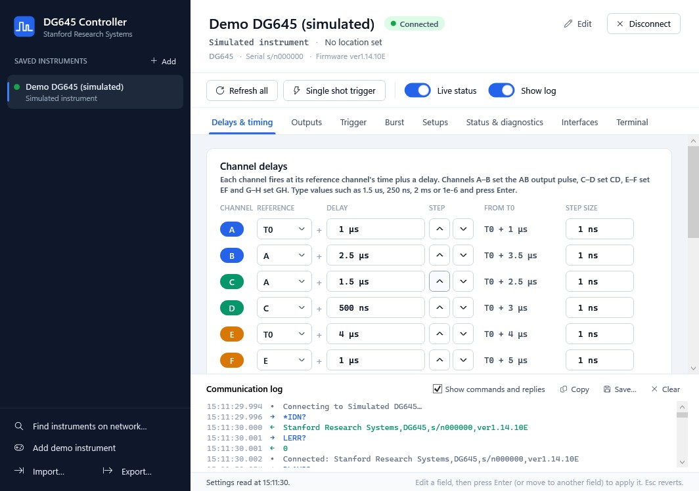
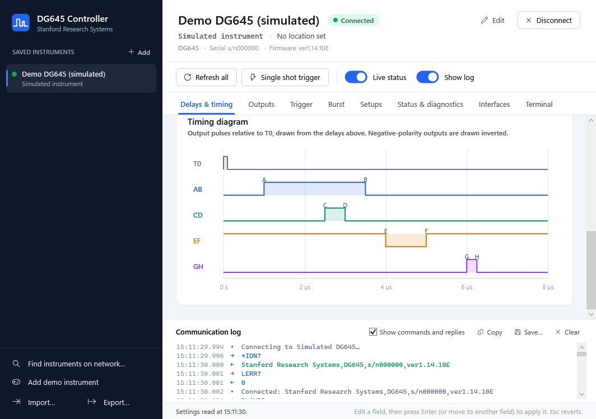
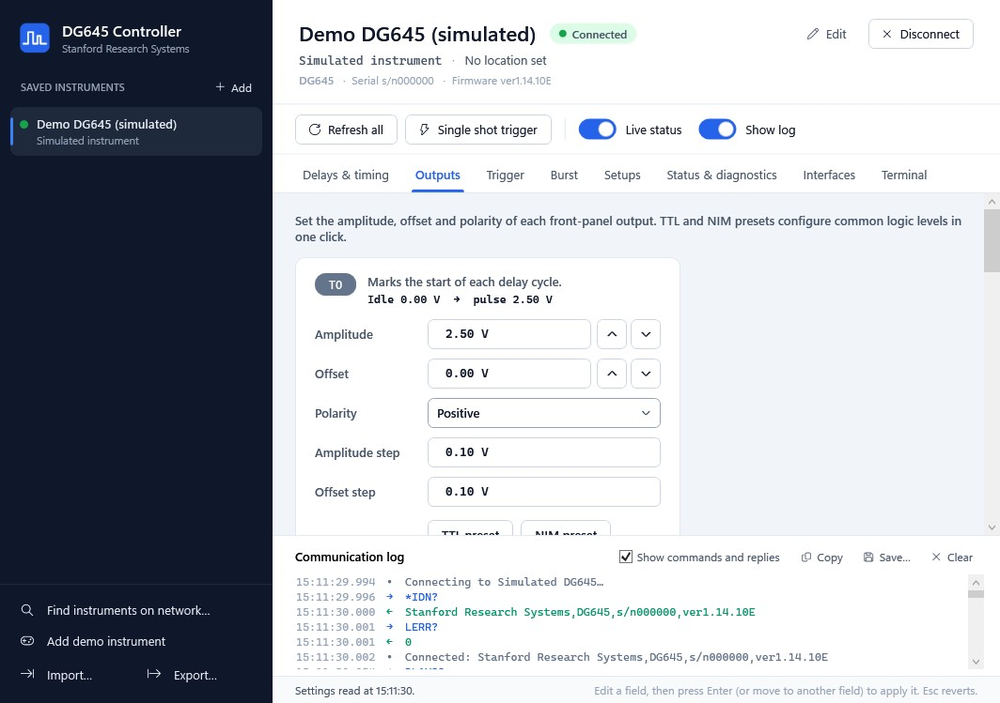
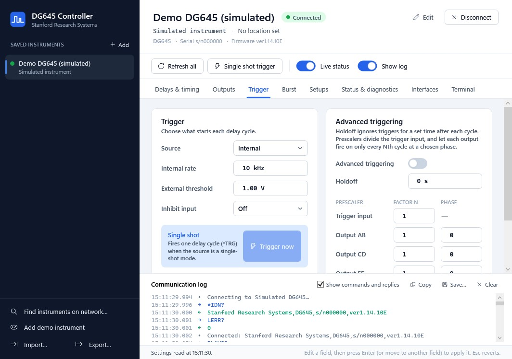
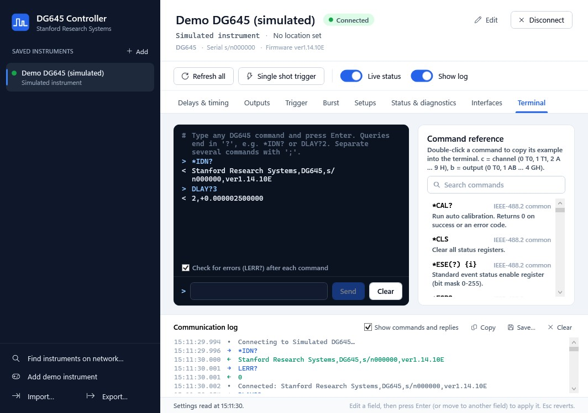

# Stanford DG645 Controller

A Windows 10/11 desktop application for controlling **Stanford Research Systems DG645 Digital Delay
Generators** over Ethernet (TCP/IP).

Save each instrument once under a friendly name ("Laser lab DG645", "Beamline trigger") and pick it from
a list: there is no need to remember IP addresses. Every setting the DG645 exposes over its remote
interface is available, laid out in clear pages with live feedback from the instrument.



## Download

Get **`StanfordController.exe`** from the [latest release](../../releases/latest).

It is a single self-contained executable: the .NET runtime and all dependencies are bundled inside, so
there is nothing to install. Copy it anywhere and run it. Windows SmartScreen may ask for confirmation
the first time because the executable is not code-signed.

A new release is built automatically every time `main` changes (see [Releases](#how-releases-are-made)).

## Features

* **Saved instruments.** Friendly name, IP address or host name, port, location and notes. Add, edit,
  duplicate, reorder, remove, and import/export the list to share it with colleagues.
* **Find instruments on the network.** Scans the PC's local subnets for instruments on port 5025 and
  reads their identity, or checks a single address. Add one with a click.
* **Connection test** before saving, and several instruments connected at once.
* **Delays & timing.** Channels A–H with reference channel (T0, A–H) and delay, step size and ▲/▼ step
  buttons, time from T0, and a live timing diagram of the AB, CD, EF and GH pulses. Values accept
  units: `1.5 us`, `250 ns`, `2 ms`, `1e-6`.
* **Outputs.** Amplitude, offset, polarity and their step sizes for T0, AB, CD, EF and GH, with
  one-click TTL and NIM presets and a readout of the idle and pulse levels.
* **Trigger.** Source (internal, external rising/falling, single-shot, line), internal rate, threshold,
  inhibit, single-shot trigger, advanced triggering, holdoff, and prescale factors and phases.
* **Burst mode.** Enable, count, period, delay and T0 behaviour, with a plain-English summary.
* **Setups.** Save and recall the nine setups in the instrument's memory, reset to defaults, and save
  or load the complete configuration as a `.dg645.json` file to archive or copy to another DG645.
* **Status & diagnostics.** Live instrument status register, standard event status and status byte with
  their enable masks, power-on status clear, error queue, self test, auto calibration, timebase,
  front-panel display selection and identity.
* **Interfaces.** All LAN, RS-232 and GPIB settings (DHCP, Auto-IP, static IP, bare socket, telnet,
  VXI-11, address, mask, gateway, baud rate, GPIB address), interface resets, MAC address, local/remote
  and the control lock.
* **Terminal.** Send any command by hand, with history, automatic error checking and a searchable
  command reference.
* **Communication log** of every command and reply, which can be copied or saved.
* **Demo instrument.** A built-in simulated DG645 for trying the program without hardware.
* Every value written is read back from the instrument, so the screen always shows what the DG645
  actually accepted. Rejected values are highlighted with the instrument's own error message.

## Screenshots

These are rendered by the CI smoke test against the built-in simulated DG645, at the program's minimum
window size.

| | |
| --- | --- |
|  |  |
| Timing diagram drawn from the channel delays | Output amplitude, offset, polarity and presets |
|  |  |
| Trigger source, levels, inhibit and prescalers | Command terminal with searchable reference |

## Using it

1. Make sure the DG645 is on the network and its **bare socket** interface is enabled (the default).
   Its IP address is shown in the front-panel network settings.
2. Click **Add** (or **Find instruments on network…**), give the instrument a name, enter its address,
   and click **Test connection**, then **Save**.
3. Double-click the instrument (or click **Connect**). All settings are read from the instrument.
4. Change a value and press **Enter**, or move to another field, to apply it. **Esc** reverts an edit.
   Fields with unapplied edits are outlined in amber; rejected values are outlined in red.

Saved instruments are stored in `%APPDATA%\StanfordController\instruments.json`.

When you disconnect or close the program, the instrument's front panel is returned to local control
(this can be turned off per instrument).

## Documentation

* [`docs/DG645-Command-Reference.md`](docs/DG645-Command-Reference.md): the DG645 remote command set,
  parameters, status registers and error codes, and where each command appears in the program.
* [`docs/manuals/`](docs/manuals/README.md): the official Stanford Research Systems manual and data
  sheet. If the PDFs are not there yet, run the **Fetch DG645 manuals** workflow from the Actions tab
  (or `scripts\Download-Manuals.ps1`).

> **Model number.** Stanford Research Systems' Ethernet-controlled delay generator is the **DG645**
> (there is no "DG465"). The older DG535 has no Ethernet interface.

## Building from source

Requirements: the [.NET 10 SDK](https://dotnet.microsoft.com/download). Open `StanfordController.sln`
in Visual Studio 2026 or any IDE with .NET 10 support, or use the command line:

```powershell
dotnet test                                   # unit and simulator tests
dotnet run --project src/StanfordController.App
dotnet publish src/StanfordController.App -c Release -o publish   # → publish\StanfordController.exe
```

The libraries and tests also build and run on Linux and macOS; the WPF application compiles there too
but only runs on Windows.

`StanfordController.exe --smoke-test <folder>` runs the UI against the simulated instrument, visits
every page and dialog, writes screenshots to the folder and exits with a non-zero code on any error.
CI uses it to catch XAML problems that compile cleanly.

### Project layout

| Path | Contents |
| --- | --- |
| `src/StanfordController.Core` | DG645 protocol: TCP transport, typed client for every command, settings snapshots, simulator, saved-instrument store, network discovery. |
| `src/StanfordController.Presentation` | View models for every page (UI logic, testable without Windows). |
| `src/StanfordController.App` | The WPF application: windows, pages, styles. |
| `tests/StanfordController.Tests` | Unit tests, simulator tests and real-socket tests. |
| `docs/` | Command reference and official documents. |
| `.github/workflows/` | CI/release and manual-download workflows. |

## How releases are made

[`.github/workflows/build-and-release.yml`](.github/workflows/build-and-release.yml) runs on Windows for
every push and pull request: it builds, runs the tests, publishes the single-file exe and runs the UI
smoke test. The exe is attached to each run as an artifact.

On every push to **`main`** it also creates a GitHub Release named `v1.0.<run number>` containing
`StanfordController.exe` and its SHA-256 checksum. The newest release is always available at
`releases/latest/download/StanfordController.exe`.
