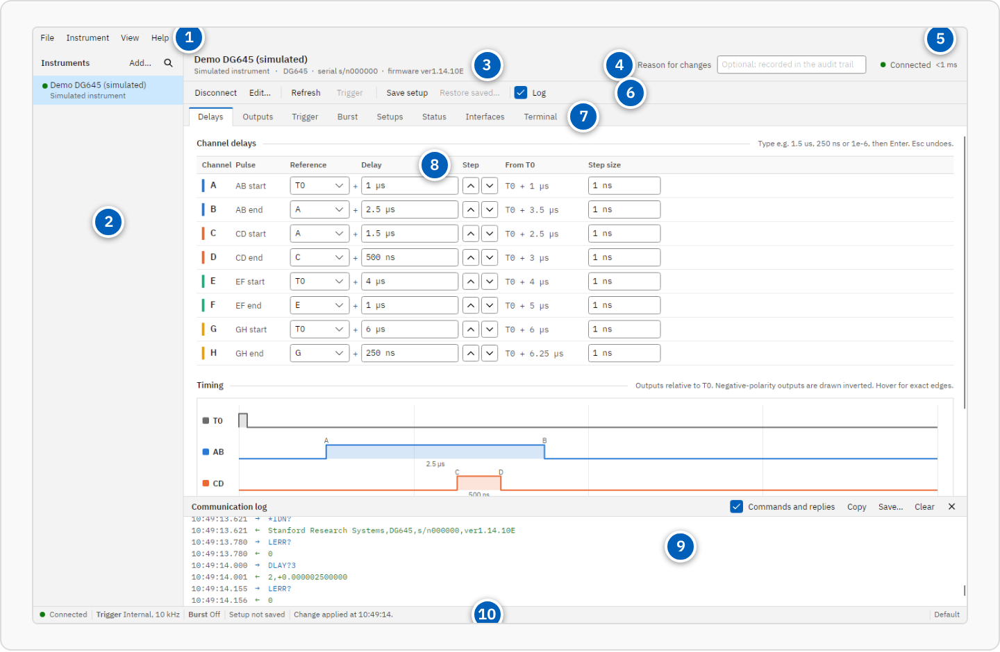
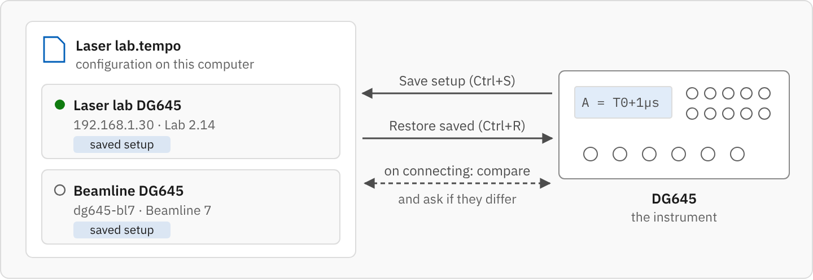
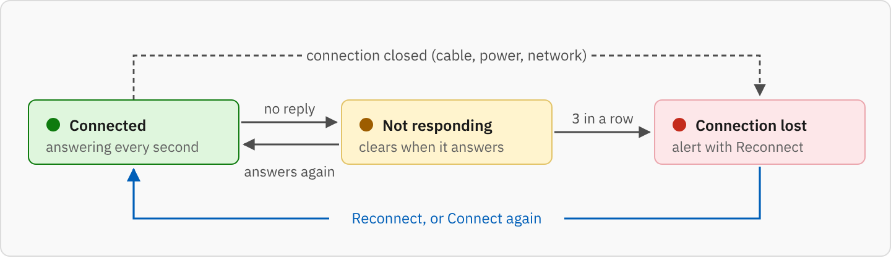
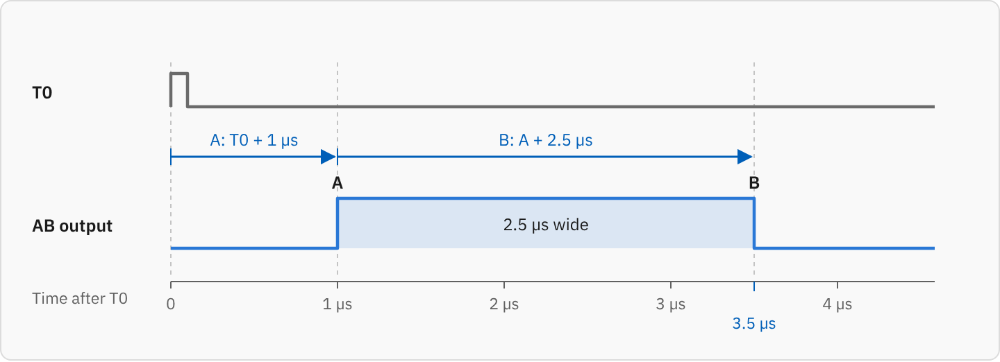
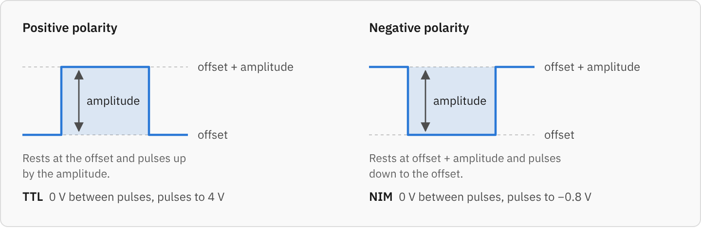
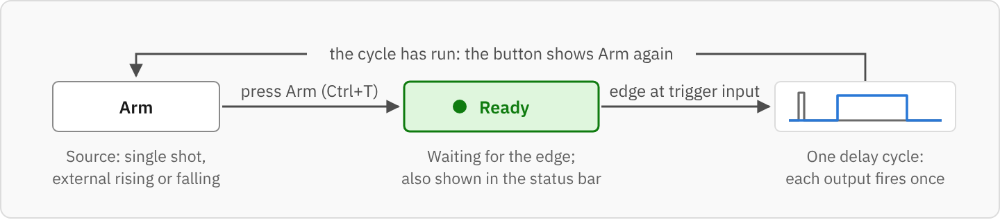
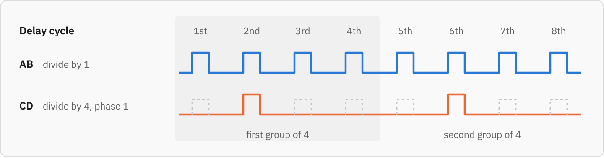
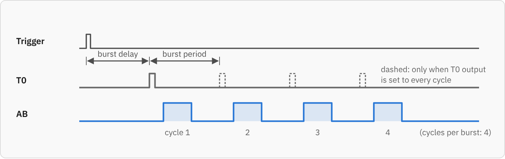

# Tempo user guide

Tempo (short for *Timing & Event Manager for Pulse Outputs*) controls Stanford Research Systems **DG645** digital delay generators over Ethernet. It gives every instrument a name you choose, shows all of its settings on eight pages, and keeps complete setups in configuration files on your computer, so a day's work can be put back on the instrument with one click.

Press F1 anywhere in Tempo to open this guide at the page you are working on.

New to Tempo? Print the [quick reference card](Tempo-Quick-Reference.pdf) on both sides of one sheet of A4 and keep it by the instrument: getting started on one side, everyday tasks on the other. **Help ▸ Quick reference card (PDF)** opens it in your web browser.

Quick links: [Getting started](#getting-started) · [Configurations and saved setups](#configurations-and-saved-setups) · [Keyboard shortcuts](#keyboard-shortcuts) · [Troubleshooting](#troubleshooting)

## Getting started

### Which download

Every release on the GitHub releases page has these files:

| File | Use it for |
| --- | --- |
| `Tempo.exe` | Windows 10 and 11. Keeps your configurations in `%APPDATA%\Tempo`. |
| `Tempo-Portable.exe` | Windows, run from a USB stick or a shared folder. Keeps everything in a `Tempo-data` folder beside the program and writes nothing else to the computer. |
| `tempo-dg645_<version>_amd64.deb` | Debian, Ubuntu and their derivatives. |
| `PKGBUILD` | Arch Linux and its derivatives. |
| `Tempo-<version>-linux-x64.tar.gz` | Any 64-bit Linux desktop: the program, a menu entry and an install script. |
| `Tempo-linux-x64`, `Tempo-Portable-linux-x64` | The bare Linux program, normal and portable. |
| `Tempo-Quick-Reference.pdf` | The quick reference card, to print. |
| `SHA256SUMS.txt` | Checksums, to confirm a download is complete and unaltered. |

Nothing else needs installing: the .NET runtime, the user interface library and the fonts are inside the program file.

### Installing

**Windows.** Save `Tempo.exe` anywhere (for example your Desktop or `C:\Tools`) and double-click it. The program is not code-signed, so the first time Windows may say *"Windows protected your PC"*: choose **More info**, then **Run anyway**.

**Debian or Ubuntu.** `sudo apt install ./tempo-dg645_<version>_amd64.deb`, then start Tempo from the applications menu or run `tempo-dg645`.

**Arch Linux.** Put the `PKGBUILD` in an empty folder and run `makepkg -si`. It downloads the release tarball, checks its checksum and installs Tempo as the `tempo-dg645-bin` package.

**Other Linux.** Unpack the tarball and run `./install.sh` (for yourself, in `~/.local`) or `sudo ./install.sh --system` (for everyone, in `/usr/local`). You can also run `./tempo-dg645` straight from the folder. If you download a bare program file instead, make it executable first with `chmod +x Tempo-linux-x64`.

Tempo on Linux needs an X11 or XWayland desktop session, which every desktop distribution provides.

### First connection

1. Connect the DG645 to your network (or straight to the computer; see [Connecting the instrument directly](#connecting-the-instrument-directly)) and switch it on.
2. Start Tempo. If you know the instrument's IP address, choose **Instrument ▸ Add…** (Ctrl+N). If not, choose **Instrument ▸ Find on network…** (Ctrl+F) and press **Scan**.
3. Give the instrument a name you will recognise, such as *Laser lab DG645*, press **Test connection** to check that it answers, then press **Save**.
4. Double-click the instrument in the list on the left (or press **Connect**). Tempo reads every setting and shows them on the pages.
5. Make your changes, then press Ctrl+S to save the setup in the configuration on this computer.

No hardware to hand? **Instrument ▸ Add demo instrument** adds a simulated DG645 that behaves like the real one, so you can try every page.

### Finding the instrument's address

The DG645 shows its IP address in the network (TCP/IP) settings on its front panel; its operation manual describes the keys. If the address comes from your network (DHCP), your network administrator or your router's list of connected devices also shows it.

Easiest of all is **Find on network…**, which looks for DG645s on this computer's networks; see [Finding instruments on the network](#finding-instruments-on-the-network).

## The main window

1. **Menu bar.** *File* opens and saves configurations and setups. *Edit* undoes and redoes changes (see [Undo and redo](#undo-and-redo)). *Instrument* acts on the instrument selected in the list. *View* shows the communication log and the audit trail, and sets the alert sound and the theme. *Help* opens this guide and the quick reference card.
2. **Instrument list.** Every instrument in the open configuration, with its address and location. The dot shows the connection: hollow when not connected, green when connected, amber while connecting or not responding, and red when the connection failed or was lost. Double-click to connect; right-click for the other actions.
3. **Header.** The instrument's name, address, model, serial number and firmware.
4. **Reason for changes.** Optional; recorded with each change in the [audit trail](#reason-for-changes).
5. **Connection state.** The [heartbeat](#heartbeat-and-alerts): the time the instrument took to answer, or how long it has been silent.
6. **Command bar.** **Connect / Disconnect**, **Edit…**, **Refresh**, **Trigger** (which reads **Arm** or **Ready** in the [single-shot external modes](#single-shot-and-arming)), **Undo** and **Redo**, **Save setup**, **Restore saved…** and the **Log** check box.
7. **Pages.** Delays, Outputs, Trigger, Burst, Scan, Setups, Status, Interfaces and Terminal, one tab each, described below, and **All channels**, which lists the channels of every connected instrument.
8. **Value fields.** Type a value and press Enter; see [Entering values](#entering-values).
9. **Communication log.** Every command sent and reply received, with the time; see [Communication log](#communication-log).
10. **Status bar.** The connection state, the trigger source and rate (with a green **Ready** while a single shot is armed), whether burst mode is on, **Setup not saved** when the instrument's settings have changed since its setup was last saved, the latest message, and the name of the open configuration. **Portable** appears when you are running the portable program.

A button, menu item or field that is greyed out cannot be used at the moment. Hover over it to see why, for example *Not connected* or *Only available when the trigger source is a single-shot mode*, and what to do about it.

When something is wrong, an **alert bar** appears across the top of the window; see [Heartbeat and alerts](#heartbeat-and-alerts).

If commands typed in the [Terminal](#terminal) may have changed settings shown on the other pages, an amber **Pages may be out of date** button appears at the right of the command bar; press it (or F5) to read everything again.

## Saving instruments

Each instrument is saved once, with a friendly name, so you never need to remember its IP address.

### Adding an instrument

**Instrument ▸ Add…** (Ctrl+N) opens the instrument editor:

| Field | Meaning |
| --- | --- |
| Name | What appears in the list. Must be unique within the configuration. |
| Address | The IP address (such as `192.168.1.30`) or host name (such as `dg645-lab2`). |
| TCP port | 5025, the DG645's bare-socket port. Only change it if a network device forwards a different port to the instrument. |
| Reply timeout | How long to wait for an answer, in milliseconds. 3000 suits most networks; raise it for slow or remote links. |
| Location, Notes | Free text, shown when the instrument is selected. |
| On opening | Connect automatically when this configuration opens, including when Tempo starts. |
| Saved setup | What to do on connecting when the instrument's settings differ from the setup saved in Tempo; see [Configurations and saved setups](#configurations-and-saved-setups). |
| On disconnecting | Return the front panel to local control (it is locked while Tempo is connected). |

**Test connection** opens a connection, asks the instrument to identify itself and closes again, so you can check the details before saving. The editor will not save while a field is invalid; the problems are listed at the bottom.

### Editing, copying and removing

Select an instrument, then use the **Instrument** menu or right-click it:

- **Edit…** (F2) changes any of the fields above. A new address for a connected instrument takes effect the next time it connects.
- **Duplicate…** copies an instrument, including its saved setup, for example when several identical instruments share a setup.
- **Move up** and **Move down** reorder the list.
- **Remove…** (Delete, in the list) removes the instrument and its saved setup from the configuration. The instrument itself is not changed.

### Finding instruments on the network

**Instrument ▸ Find on network…** (Ctrl+F) lists this computer's IPv4 networks. **Scan** looks for anything answering on the port shown (5025) and asks each answer for its identity (`*IDN?`). To keep the scan quick, a network of more than 1,022 addresses is narrowed to the 254 around this computer's own address.

To check one address instead, type it under **One address** and press **Check**. This is the way to reach an instrument on another subnet, or one connected directly to the computer.

Select a result and choose **Add selected…** (or double-click it) to open the instrument editor with the address filled in. If the address is already saved, Tempo selects that instrument instead.

The scan finds nothing if a firewall blocks outgoing connections on port 5025, if the instrument's bare-socket interface is turned off, or if the instrument is on a network this computer is not directly attached to.

## Configurations and saved setups

A **configuration** is a file on your computer that holds your instruments and, for each, its complete saved setup: every channel delay and reference, every output's amplitude, offset and polarity, the trigger, the prescalers and burst mode. It lets you switch the system on tomorrow and have everything exactly as you left it.

### The open configuration

Tempo always has one configuration open; its name is in the title bar and at the right of the status bar. The first time you run Tempo it creates **Default** (`Default.tempo` in the [data folder](#files-and-folders)). Changes to instruments (adding, editing, reordering, removing) are written to the open configuration straight away. Tempo reopens the last configuration you used when it starts.

| File menu | What it does |
| --- | --- |
| New configuration… | Starts an empty configuration in a new file. |
| Open configuration… (Ctrl+O) | Switches to another configuration file. Connected instruments are disconnected first, then Tempo connects the new file's instruments; see [Opening a configuration](#opening-a-configuration). |
| Open recent | The configurations opened most recently. |
| Save configuration as… (Ctrl+Shift+S) | Saves everything, including the current setup of every connected instrument, under a new name, and switches to that file. |
| Connect all instruments on opening | When ticked, opening a configuration connects every instrument in it without asking. |
| Save setups (Ctrl+S) | Saves the complete setup of every connected instrument into the open configuration. |
| Import instruments… | Adds the instruments from another configuration file to this one. |

Configuration files end in `.tempo` and contain plain JSON, so they can be kept with your experiment notes, put under version control, or copied to another computer.

A good way to work is one configuration per experiment or lab, such as *Laser lab.tempo* or *Beamline 7.tempo*.

### Saving a setup

When an instrument is set up the way you want, save its setup:

- **File ▸ Save setups** (Ctrl+S) saves every connected instrument at once.
- **Save setup** on the command bar or the [Setups](#setups) page saves just this instrument.

Tempo reads every setting back from the instrument, so what is saved is exactly what the instrument is doing. After you change anything, the status bar shows **Setup not saved** and the title bar gains an asterisk; if you close Tempo or open another configuration with unsaved setups, it asks whether to save them.

### Putting a saved setup back

**Restore saved…** (Ctrl+R) first reads the instrument and lists each setting that restoring would change, with its value now and in the saved setup; press **Restore** to go ahead. It then writes the saved setup to the instrument and reads every page back. If the instrument already matches the saved setup, Tempo says so and changes nothing. Tempo applies the settings in an order that avoids temporary conflicts between linked channels, so the instrument ends up with exactly the saved setup.

### When an instrument connects

The instrument may have been changed since its setup was saved: at its front panel, by another program, or by a reset. So when an instrument with a saved setup connects, Tempo compares its settings with the saved setup:

- If they match, the status bar says so and nothing else happens.
- If they differ, Tempo lists what differs (for example *Delay C*, *Trigger rate*, *CD amplitude*) and asks whether to **Load saved setup** or **Keep instrument settings**.

Tick **Remember my choice for this instrument** to stop the question; you can change the choice later under **Saved setup** in the instrument editor (F2):

| Choice | On connecting, if the settings differ |
| --- | --- |
| Ask which settings to use | Tempo asks, as above. This is the default. |
| Load the setup saved in Tempo | The saved setup is applied without asking. |
| Keep the settings on the instrument | The instrument is left as it is; the status bar shows *Setup not saved* until you save or restore. |

Combined with **Connect when this configuration opens**, *Load the setup saved in Tempo* gives a system that is fully set up a few seconds after the computer and instruments are switched on.

### Opening a configuration

A configuration can hold several DG645s, so opening one can put a whole bench back as it was. When you open a configuration with **File ▸ Open configuration…**, Tempo connects its instruments one after another:

- Instruments with **Connect when this configuration opens** ticked always connect.
- If some are not ticked, Tempo lists them all and asks **Connect all**, or connect only the ticked ones (*Not now* if none are). Tick **Always connect every instrument when I open a configuration** to stop the question; **File ▸ Connect all instruments on opening** turns it back off.
- As each instrument connects, Tempo compares it with its saved setup as described in [When an instrument connects](#when-an-instrument-connects).
- An instrument that cannot be reached turns red in the list and is skipped, and the others still connect. The status bar says which ones did not connect.

When Tempo starts, it reopens the last configuration and connects the ticked instruments (or all of them, if you chose that) without asking.

### A different unit at the same address

Tempo remembers the serial number of the DG645 at each address. If a different unit answers there (for example, after an instrument has been swapped or its IP address reused), Tempo shows the serial number saved for that instrument and the one answering now, before doing anything else:

- **Use new unit** connects it in place of the old one. Tempo remembers the new serial number, then compares the instrument with the saved setup as usual. The audit trail records the change of unit.
- **Cancel** leaves it disconnected and keeps the old serial number.

While a configuration is opening, the choices are **Use new unit**, **Skip** (leave this instrument disconnected and go on to the next) and **Cancel** (stop connecting the rest).

### Setup files for one instrument

The [Setups](#setups) page can also export a single instrument's setup to a `.dg645.json` file and import one, for sending a setup to a colleague or loading it into a different DG645. Configurations are the better choice for your own day-to-day work, because they keep every instrument's setup together with its connection details.

## Connecting

Double-click an instrument, press **Connect** or press Ctrl+K. Tempo:

1. opens a TCP connection to the instrument (port 5025),
2. asks it to identify itself and clears any old errors,
3. reads every setting and fills in all the pages,
4. compares the instrument with its saved setup, if it has one (see [When an instrument connects](#when-an-instrument-connects)),
5. starts the [heartbeat](#heartbeat-and-alerts), which checks the instrument every second.

While Tempo is connected the DG645 is in remote mode and its front panel is locked. **Disconnect** (Ctrl+Shift+K) closes the connection and, unless you untick the option in the instrument editor, returns the front panel to local control. Closing Tempo disconnects every instrument.

If the connection drops (the cable is pulled, the instrument is switched off, the network fails), the heartbeat notices within seconds and an alert appears (see below).

Several instruments can be connected at the same time; select one in the list to see its pages.

### Heartbeat and alerts

While an instrument is connected, Tempo checks it every second by reading its status register. This is the **heartbeat**. Each reply shows the connection is alive and carries the instrument's fault flags. The header shows how long the last reply took (for example *Connected 4 ms*); hover over it for the time of the last reply.

When something is wrong, an **alert** appears in the bar across the top of the window, whichever instrument you are looking at. Connection alerts clear themselves when the instrument is back; fault alerts stay until you dismiss them (×):

| Alert | When | What to do |
| --- | --- | --- |
| **Not responding** (amber) | The instrument missed a heartbeat. Its dot turns amber and the header shows how long it has been silent. | Usually nothing: the alert clears by itself as soon as the instrument answers again. Check that it is switched on and its network cable is in. |
| **Connection lost** (red) | The instrument missed three heartbeats in a row (about 10 seconds with the default reply timeout), or the connection was closed. Its dot turns red. | Check power and cabling, then press **Reconnect** in the alert. Reconnecting clears the alert. |
| **Timebase PLL unlocked** (red) | The DG645 reports its 100 MHz phase-locked loop came unlocked (*PLL_UNLOCK*), so timing may have been wrong. | Check the timebase, and the external 10 MHz reference if one is used. |
| **Rubidium timebase unlocked** (red) | An optional rubidium timebase reports it is unlocked (*RB_UNLOCK*). | Wait for it to lock after power-on (several minutes); if it persists, check the instrument. |
| **Timebase changed** (red) | The timebase in use changed, for example from *External reference* to *Internal crystal*. Checked every 10 seconds. | An external reference may have been unplugged or lost. |

A problem that happens again updates its alert (*3 times since 14:03:12, last at 14:05:40*) instead of adding another. **Show** selects the instrument. When an alert appears, the window asks for attention (on Windows, its taskbar button flashes if another program is in front) and, on Windows, plays the system alert sound; **View ▸ Alert sound** turns the sound off. Every alert is also recorded in the [audit trail](#audit-trail), as is the time the instrument answered again.

### Connecting the instrument directly

With an Ethernet cable straight from the computer to the DG645 and no network in between, neither end gets an address from DHCP. If **Auto-IP** is enabled on the instrument (see [Interfaces](#interfaces)), both pick a link-local address in `169.254.x.x` after a minute or so. Read the address from the DG645's front-panel network settings and enter it in the instrument editor, or under **One address** in the **Find on network** window. (A scan does not help here: the link-local network has 65,536 addresses, so Tempo scans only the 254 around the computer's own.)

## Entering values

Every value field works the same way:

- Type the new value and press Enter to send it to the instrument. Moving to another field, or clicking anywhere outside the field, sends it too. Esc puts the instrument's value back.
- While you are typing, the field is amber: the value has not been sent yet.
- After sending, Tempo reads the value back, so the field always shows what the instrument actually holds, including any rounding it applied.
- If the instrument rejects the value, the field turns red and the reason appears under it, for example *Illegal delay (error 12)*.

Numbers take the usual SI prefixes, with or without the unit and with or without a space:

| Kind | Examples | Prefixes |
| --- | --- | --- |
| Time | `1.5 us`, `1.5µs`, `250ns`, `2 ms`, `1e-6`, `0.5 s` | `p` `n` `u` (or `µ`) `m` |
| Frequency | `10 kHz`, `2.5k`, `1MHz`, `500 mHz` | `u` `m` `k` `M` `G` |
| Voltage | `2.5 V`, `800 mV`, `-0.8` | `m` |

A number with no prefix is in seconds, hertz or volts. Tempo always uses a full stop as the decimal point, whatever your computer's regional settings.

The up and down buttons beside some fields step the value by its step size, which the DG645 keeps for each setting.

## Undo and redo

**Edit ▸ Undo** (Ctrl+Z), or **Undo** on the command bar, takes back the last change Tempo made to the selected instrument by writing the old value again. **Edit ▸ Redo** (Ctrl+Y or Ctrl+Shift+Z) makes it again. The menu names the change, for example *Undo Delay A*, and hovering over **Undo** shows the value it goes back to.

Everything you change on the pages can be undone: values, step buttons, choices and check boxes, output presets, [pulses](#pulses) (both channels at once), and a [delay scan](#delay-scans) that left a channel at its last value. Restoring or importing a setup, recalling from the instrument's memory and resetting are undone in one step too: Tempo puts back every setting as it was read just before.

Each instrument keeps its own list of the last 100 changes while it is connected; disconnecting clears it. Commands typed in the [Terminal](#terminal) and changes made at the front panel are not on the list. An undone change is recorded in the [audit trail](#audit-trail) as *Undone*, and a redone one as *Redone*, with the old and new values.

While the cursor is in a value field, Ctrl+Z undoes your typing in that field instead; Esc puts the instrument's value back.

## Delays and timing

### Channel delays

The DG645 has eight delay channels, A to H, plus T0, which marks the start of each delay cycle. Each channel fires at a delay after a **reference** channel:

> *channel time = reference time + delay*

The **From T0** column works out each channel's time after T0 through the whole chain of references.

Pairs of channels make the four front-panel output pulses:

| Output | Starts at | Ends at |
| --- | --- | --- |
| AB | A | B |
| CD | C | D |
| EF | E | F |
| GH | G | H |

The coloured bar beside each channel shows which output it belongs to; the **Pulse** column says whether the channel starts or ends it. Delays run from 0 to 2000 s, in steps as fine as 5 ps.

To set a delay, type it in **Delay** and press Enter. To make a channel follow another, choose its **Reference**; the delay value stays the same, so its time from T0 changes. The up and down buttons move a delay by its **Step size** (the instrument's `SPDL` step).

**Example: a 2.5 µs pulse on AB, starting 1 µs after T0.** Set A to reference T0 with delay `1 us`, and B to reference A with delay `2.5 us`. B then fires 3.5 µs after T0, and because B follows A, moving A moves the whole pulse and keeps its width.

### Channel labels

The **Label** column at the right of the table names each channel after what it drives, such as *Q-switch* or *Camera gate*. Click in it, type, and press Enter (or click elsewhere); Esc puts the previous label back, and clearing the text removes the label. A channel without a label shows a faint *Add label*.

Labels belong to the instrument, not to its setup: they are written to the open configuration straight away, without **Save setup**, come back whenever the instrument connects, and are not changed by restoring, importing or recalling a setup. Each change is recorded in the [audit trail](#audit-trail). Resting the pointer on a channel's letter shows its label with its role, and the [All channels](#all-channels) page lists the labels of every connected instrument.

### Pulses

The **Pulses** table under the channel delays sets each output by when its pulse starts and how long it lasts, which is often simpler than working out two channel delays. Type a **Start** (from T0) or a **Width** and press Enter; **End** shows where the pulse then finishes.

Tempo sets the two channels for you: the end channel (B, D, F or H) follows the start channel by the width, and the start channel keeps its reference and gets the delay that puts it at the start time. Typing a new start moves the whole pulse and keeps its width; typing a new width keeps the start. If the start channel's reference itself follows the end channel, Tempo references it to T0 instead, so the two can never form a loop. The **Channel delays** table above shows the result, and a note beside a pulse says when its end channel does not yet follow its start.

**Example:** to make AB a 2.5 µs pulse starting 1 µs after T0, type `1 us` in AB's **Start** and `2.5 us` in its **Width**. Tempo sets A to T0 + 1 µs and B to A + 2.5 µs.

A pulse change is one step for [Undo](#undo-and-redo), and each channel it changes is recorded in the audit trail.

### Timing diagram

Below the table, the diagram draws T0 and the four outputs on one time axis, from T0 to just after the last edge, with each pulse's start and end channel above it and its width beside it. Outputs set to negative polarity are drawn upside down, as they appear on an oscilloscope.

Hover over the diagram to see the time under the pointer and, for the row you are on, the exact times of both edges, the pulse width and the polarity.

To look closely at part of the diagram, zoom in: hold Ctrl and turn the mouse wheel over the diagram (it zooms around the pointer), or use **Zoom in** and **Zoom out** above it, or press + and − after clicking the diagram. While zoomed in, drag the diagram sideways (or hold Shift and turn the wheel, or press the arrow keys) to move along the time axis, and the axis says which part of the whole range is shown. **Fit** (or 0) shows everything again. Turning the wheel without Ctrl scrolls the page as usual.

To measure, click in the diagram: the first click places cursor 1 and the second cursor 2. A click within a few pixels of an edge snaps to it exactly. The time between the cursors (Δt) is shown across the top of the diagram, and the line above it gives both cursor times and the matching frequency. While cursor 1 is placed, the hover read-out also gives the time from it. A third click starts again from cursor 1; **Clear cursors** or Esc removes them.

**Save image…** saves the diagram as it is shown, cursors included, as a PNG picture, for example for a lab notebook or a report. If an output has its end before its start, the diagram says so instead of drawing a pulse.

With [burst mode](#burst) on, the time axis starts at the trigger instead and the diagram repeats every output once per delay cycle: the first cycle starts after the burst delay, and each next one a burst period later. T0 is drawn on every cycle or only the first, following the burst's T0 setting. Every cycle of the burst is drawn, and the top right of the diagram gives the count. Only a very long burst, with more cycles than fit side by side, is cut short; the diagram then says how many of them it shows. Hovering also shows which cycle the pointer is in and when that cycle starts.

## Outputs

Each front-panel output (T0, AB, CD, EF, GH) has:

- **Amplitude**: the height of the pulse, in volts.
- **Offset**: the output's low level, in volts.
- **Polarity**: a positive output rests at the offset and pulses up by the amplitude; a negative output rests at offset + amplitude and pulses down to the offset.

Under each row, Tempo shows the resulting idle and pulse levels (for example *Idle 0.00 V → pulse 2.50 V*) and when the pulse happens.

The **TTL** and **NIM** buttons set an output for common logic levels in one go:

| Preset | Amplitude | Offset | Polarity | Result |
| --- | --- | --- | --- | --- |
| TTL | 4.00 V | 0.00 V | Positive | 0 V idle, 4 V pulses |
| NIM | 0.80 V | −0.80 V | Negative | 0 V idle, −0.8 V pulses |

The DG645 refuses combinations outside its output range; the reason appears under the field. **Step sizes** sets how far the up and down buttons move each amplitude and offset.

## Trigger

### Trigger source

The source decides what starts each delay cycle:

| Source | Starts a cycle |
| --- | --- |
| Internal | At the internal rate, from 100 µHz to 10 MHz. |
| External, rising edge / falling edge | On each edge at the rear-panel trigger input crossing the threshold. |
| Single shot, external rising / falling | On the next edge at the trigger input after you **Arm** the instrument; see [Single shot and arming](#single-shot-and-arming). |
| Single shot | Each time you press **Trigger** (Ctrl+T). |
| Line (AC mains) | Once per mains cycle. |

**External threshold** sets the trigger input level, between −3.5 V and +3.5 V. **Inhibit input** chooses what the rear-panel INHIBIT input blocks while it is high: nothing, all triggers, or one or more outputs.

### Single shot and arming

The trigger button on the command bar, the button under **Single shot** on this page and Ctrl+T all send `*TRG`. They are available only when the source is a single-shot mode, and what they do depends on which:

- **Single shot.** The button reads **Trigger** (**Trigger now** on this page) and starts one delay cycle straight away.
- **Single shot, external rising** or **falling.** The button reads **Arm**. Arming tells the DG645 to start one delay cycle on the next edge at its trigger input. While it waits, the button reads **Ready** in green, and the status bar shows **Ready** beside the trigger source, so it is visible from every page. When the edge arrives, the button goes back to **Arm** for the next shot. Clicking **Ready** arms the instrument again.

Tempo notices the shot with the [heartbeat](#heartbeat-and-alerts), which reads the instrument's status register every second, so **Ready** can stay on for up to a second afterwards. Choosing another trigger source, resetting the instrument, recalling or restoring a setup, or disconnecting clears **Ready**. If the instrument is armed from its front panel, Tempo cannot tell, and the button stays at **Arm**.

### Advanced triggering

Turn on **Advanced triggering** to use:

- **Holdoff**: the shortest time after a trigger before another is accepted.
- **Prescalers**: the trigger prescaler starts a delay cycle on only every *N*th trigger. Each output's prescaler then lets that output fire on only every *N*th delay cycle, on the cycle chosen by its **Phase** (0 to *N*−1).

**Example:** to fire AB on every cycle but CD on every fourth cycle, starting with the second, set CD's *Divide by N* to 4 and its *Phase* to 1.

## Burst

In burst mode, each trigger starts a train of delay cycles instead of one:

| Setting | Meaning |
| --- | --- |
| Cycles per burst | How many delay cycles each trigger produces. |
| Burst period | The time between the starts of consecutive cycles, from 100 ns. |
| Burst delay | The time from the trigger to the first cycle. |
| T0 output | Whether T0 fires on every cycle of the burst or only the first. |

Below the settings, Tempo describes the burst in words, including when its last cycle starts. The status bar shows *Burst* followed by the count and period while burst mode is on.

## Delay scans

The **Scan** page steps one channel's delay through evenly spaced values, staying at each for a set time, for example to find the timing that gives the best signal:

| Setting | Meaning |
| --- | --- |
| Channel | The channel whose delay changes. It keeps its reference, as set on the Delays page. |
| From, To | The first and last delay, from the channel's reference. **To** can be smaller than **From** to scan downwards. |
| Values | How many delays to use, **From** and **To** included (2 to 10,000). |
| Time at each value | How long to stay at each delay before moving on, from 50 ms to an hour. |
| Put the delay back as it was when the scan ends | Ticked, the channel returns to its delay from before the scan when the scan finishes or is stopped. Unticked, it stays at the last value used, and [Undo](#undo-and-redo) can take it back. |

Below the settings, Tempo describes the scan in words, including how long it will take. **Start scan** begins; the progress bar and the line under it show which value the channel is at, and the Delays page and timing diagram follow along. **Stop** ends the scan early. Disconnecting also stops it.

The audit trail records the scan's start, with every setting above, and its end, with how many values were used and the channel's delay afterwards. The individual steps are not recorded one by one.

## Setups

The Setups page gathers every way of keeping and restoring settings:

- **Saved setup on this computer**: when the setup was last saved in the configuration, with **Save setup** and **Restore saved setup…** (see [Configurations and saved setups](#configurations-and-saved-setups)).
- **Setup files**: export this instrument's setup to a `.dg645.json` file, or import one and apply it. Before applying, Tempo lists each setting the file would change, with its value now and in the file.
- **Instrument memory**: the DG645 stores nine setups in its own memory. **Save current to** a location 1 to 9, or **Recall** one; location 0 recalls the factory defaults. These setups stay in the instrument and can also be recalled from its front panel.
- **Reset to defaults…** returns the instrument to its default settings (`*RST`).

Recall, import and reset ask before replacing the current settings, and all three can be undone afterwards with **Edit ▸ Undo** (Ctrl+Z). Tempo cannot read what an instrument memory location holds without recalling it, so recalling shows no list of changes; undo it if it was not what you wanted.

## Status and diagnostics

### Status registers

The **Instrument status** table shows the DG645's events since the lamps were last cleared: a trigger received, a trigger arriving while a cycle was in progress (*RATE*), the end of a delay or burst cycle, inhibited triggers, aborted cycles, and loss of lock of the internal PLL or an optional rubidium timebase. The heartbeat reads it every second while connected; **Read now** reads it at once. **Clear lamps** resets them.

The **Standard event status** and **Status byte** tables are the IEEE-488.2 registers. The **Enable** boxes choose which bits feed the summary bits and the service request; **Apply enable masks** writes them to the instrument. Most users never need them.

### Errors

Commands the instrument rejected appear in **Errors**, newest first, with the time, the error code, its meaning and the command that caused it. **Read error queue** collects any errors still waiting in the instrument; **Clear status** (`*CLS`) clears the instrument's registers and queue.

### Diagnostics

- **Self test** (`*TST?`) checks the instrument's hardware and reports *Passed* or the failure.
- **Auto calibration** (`*CAL?`) runs the instrument's own calibration routine. Outputs may be disturbed while it runs, so it asks first.
- **Timebase** shows whether the instrument is running from its internal crystal, an optional OCXO or rubidium oscillator, or an external reference.

**Front-panel display** chooses what the instrument's own display shows, for example a particular channel's delay, and **Identity** shows the instrument's full identification string.

## Interfaces

These are the instrument's own interface settings, stored in the DG645.

**LAN (TCP/IP).** Turn the LAN interface, DHCP, Auto-IP, static IP, the bare socket (port 5025, used by Tempo), telnet (port 5024) and the VXI-11 interface on or off, and set the static IP address, subnet mask and gateway. Changes are stored at once but only take effect when the LAN interface is reset (**Reset LAN interface…**, which closes this connection) or the instrument is switched off and on.

Take care: turning off the LAN, the bare socket, or every way of getting an address can make the instrument unreachable from Tempo. Tempo asks before turning these off, and everything can always be put right from the instrument's front panel.

**RS-232 and GPIB.** Enable the rear-panel serial and GPIB interfaces, set the baud rate and GPIB address, and reset each interface.

**Remote control.** **Go to local** unlocks the front panel while staying connected; **Go to remote** locks it again. **Request lock** gives this connection sole control: other interfaces cannot change settings until you **Release lock** (or disconnect).

## Terminal

The Terminal sends any DG645 command directly and shows the reply, for anything not on the other pages or for checking exactly what the instrument says.

- Type a command and press Enter. Queries end in `?`, for example `DLAY?2` (channel A's delay) or `TRAT?` (the trigger rate). Several commands can go on one line, separated by `;`.
- The Up and Down arrow keys recall earlier commands.
- With **Check for errors** ticked, Tempo asks the instrument for errors (`LERR?`) after each command and shows any it reports.

The **Command reference** beside it lists every DG645 command with its syntax and meaning; type in the search box to filter it, and double-click a command to put its example in the input line. In the syntax, *c* is a channel number (0 T0, 1 T1, 2 A … 9 H) and *b* an output number (0 T0, 1 AB, 2 CD, 3 EF, 4 GH). The full reference is also in [DG645-Command-Reference.md](DG645-Command-Reference.md).

Commands sent from the Terminal can change settings shown on other pages; when they might have, Tempo shows **Pages may be out of date** until you refresh.

## All channels

The **All channels** page lists the eight delay channels of every connected instrument, grouped by instrument in the order of the instrument list, with each channel's label, the pulse it belongs to, its delay and its time from T0. It is the same page whichever instrument is selected, and it follows the instruments as they connect, disconnect and change. Use it to find which unit and channel drives a piece of equipment before changing anything.

- Type in the search box to show only matching channels. Tempo looks in the labels, the channel letter (`A`), the output (`AB`) and the instrument's name and location; several words must all match, so `probe gh` finds channels G and H of the instrument called Probe. Esc clears the search.
- Under each instrument's channels is its [timing diagram](#timing-diagram), the same as on its Delays page, so the pulses of every unit can be compared on one page. Hovering a pulse shows its edges with their labels, here and on the Delays page.
- Labels can be typed here as well as on the Delays page.
- **Show** beside an instrument selects it in the instrument list.

Instruments that are not connected are not listed; the line at the top says how many there are.

## Communication log

The log under the pages records every command sent (→), reply received (←), error (✕) and connection event, with the time to the millisecond. Untick **Commands and replies** to show only connection events and errors. **Copy** puts the whole log on the clipboard and **Save…** writes it to a text file, which is the most useful thing to include when reporting a problem.

Show or hide the log with the **Log** check box, **View ▸ Communication log** or Ctrl+L. The heartbeat's status register reads are not logged, to keep the log readable; only a missed reply is.

## Audit trail

Tempo keeps a permanent record of every change it makes to an instrument, and to the saved instruments, for quality systems such as ISO 9001 (control of documented information, clause 7.5.3; control of changes, clause 8.5.6). Each record says:

- **when**, to the millisecond, with the time zone;
- **who**: the computer account, for example `LAB\jsmith`, and the computer's name;
- **which instrument**: its saved name, serial number and address;
- **what**: the action and, for a change, the setting with its old and new values;
- **why**: the reason for the change, if one was given (see below);
- **which program**: the Tempo version that made the change.

ISO 9001 certifies an organisation's quality management system rather than any program, so the audit trail does not make a laboratory compliant by itself. It gives your procedures a dependable record to point to.

### What is recorded

| Recorded | How |
| --- | --- |
| A value changed on any page | One record with the old and new value, for example *Delay C: A + 1.5 µs → A + 2 µs*. This covers delays, pulses (one record per channel), step buttons, output levels and presets, trigger, burst, prescalers, interfaces, the front-panel display and the status enable registers. |
| Undo and redo | The setting put back, with the old and new values, recorded as *Undone* or *Redone*. |
| Delay scans | The start of the scan, with its channel, values and time at each, and its end, with how many values were used and the delay afterwards. |
| Many settings changed at once | Restoring or importing a setup, recalling from the instrument's memory and resetting give one record per setting that changed. Tempo reads the setup before and after, so the record shows what really changed, even if the operation fails part-way. |
| Actions on the instrument | Triggering and arming, saving to the instrument's memory, clearing status, self test and auto calibration (with the result), interface resets, local and remote control, and the interface lock. |
| Commands typed in the Terminal | Every command that can change something, as typed, with any error the instrument reported. Queries are not recorded. |
| Connections | Connecting (with the instrument's identity), disconnecting, losing the connection, and keeping the instrument's own settings when they differ from the saved setup. |
| Heartbeat alerts | Faults the instrument reports, the instrument not responding, and when it answers again. |
| The saved instruments | Adding, importing and removing an instrument; each detail changed in the instrument editor; each channel label added, changed or removed; and saving a setup, with each setting that differs from the setup saved before. |

As a safety net, anything else Tempo sends that could change the instrument is recorded as a command, so no change Tempo makes goes unrecorded. Reading values is not recorded, and neither are changes made at the front panel or by other programs, which Tempo cannot see. When an instrument with a saved setup connects, though, Tempo shows any differences from the saved setup (see [When an instrument connects](#when-an-instrument-connects)).

### Reason for changes

While an instrument is connected, a **Reason for changes** box appears in its header, at the top of every page. Whatever you type there, for example a job, batch or change request number, is recorded with each change until you change or clear it. It is optional.

### Viewing the audit trail

**View ▸ Audit trail…** shows one month at a time, newest first. Choose an instrument to see only its records, or type in the search box to find a setting, value, user or reason. Select a record to see it in full below the list, including its details and hash. **Refresh** (F5) reads the files again; Tempo also does this whenever it records something. Ctrl+F goes to the search box.

### Where it is kept

The audit trail is a set of CSV files, one per computer per month, for example `Tempo audit trail 2026-10 LABPC1.csv`. They are in the **Audit trail** folder inside the [data folder](#files-and-folders), or in a folder you choose with **Change folder…** in the audit trail window (**Use default folder** goes back). A shared network folder that is backed up is a good choice. Each computer writes its own file, so several computers can share one folder. The files open in any spreadsheet program, and Tempo marks them read-only between writes.

If the folder cannot be written, for example because the network share is offline, records wait in Tempo and are written as soon as the folder is back. Meanwhile the status bar shows **Audit trail not written** in red. If they still cannot be written when Tempo closes, they are written to the default folder instead, and Tempo says so if even that fails.

### Checking that records have not been altered

Each record ends with a hash: a fingerprint of the record and of the record before it in the same file. **Check integrity** recomputes the chain for the month on show. It reports the first line where a record was changed, or where a record was added or removed before it. Two things it cannot catch: deleting the latest records from the end of a file, and someone recomputing every hash after editing. The files are protected against accidental change, not determined tampering, so keep them in a folder where only authorised people can delete files, and back them up.

## Appearance

**View ▸ Theme** chooses **Light**, **Dark** or **System**, which follows your operating system's light or dark setting. Both themes meet the WCAG AA contrast guidelines, and the four output colours were chosen to stay distinguishable with the common forms of colour blindness; every coloured mark also has a text label beside it.

Tempo remembers the theme, the alert sound setting, the window's size and position, whether the log is shown, and which instrument was selected.

## Keyboard shortcuts

| Keys | Action |
| --- | --- |
| F1 | Open this guide at the page you are on |
| Ctrl+N | Add an instrument |
| Ctrl+F | Find instruments on the network |
| Ctrl+K | Connect the selected instrument |
| Ctrl+Shift+K | Disconnect |
| F2 | Edit the selected instrument |
| Ctrl+S | Save the setups of all connected instruments |
| Ctrl+R | Restore the selected instrument's saved setup |
| Ctrl+O | Open a configuration |
| Ctrl+Shift+S | Save the configuration under a new name |
| F5 | Read every setting from the instrument again |
| Ctrl+T | Trigger a single shot, or arm a single shot on the next external edge (`*TRG`) |
| Ctrl+Z | Undo the last change to the selected instrument |
| Ctrl+Y or Ctrl+Shift+Z | Redo the last undone change |
| Ctrl + mouse wheel | Over the timing diagram: zoom in or out around the pointer |
| + / − / 0 | In the timing diagram (after clicking it): zoom in / zoom out / show everything |
| Left / Right | In the zoomed timing diagram: move along the time axis |
| Esc | In the timing diagram: remove the measurement cursors |
| Ctrl+L | Show or hide the communication log |
| Enter / Delete | In the instrument list: connect / remove the selected instrument |
| Enter / Esc | In a value field: send the value / put the instrument's value back |
| Up / Down | In the Terminal: previous / next command |
| Alt+Left / Alt+Right | In this guide: back / forward |
| Ctrl+F | In this guide: search |
| F5 / Ctrl+F | In the audit trail: read the files again / search |

## Troubleshooting

### Tempo cannot connect

Work through these in order:

1. **Is the address right?** Compare it with the instrument's front-panel network settings, or use **Find on network**. If the instrument uses DHCP its address may have changed; edit the saved instrument (F2).
2. **Can the computer reach it?** From a command prompt or terminal, `ping <address>` should get replies. If not, check the cable, that both are on the same network, and any VPN that may be capturing traffic.
3. **Is the bare socket on?** Tempo uses the DG645's bare-socket interface on TCP port 5025. If it has been turned off, turn it back on in the instrument's front-panel network settings.
4. **Is a firewall in the way?** Company firewalls sometimes block port 5025. Ask for outgoing TCP connections to the instrument on port 5025 to be allowed.
5. **Is something else connected?** Close other programs that talk to the instrument (another copy of Tempo, a LabVIEW or Python script), then try again.

A timeout means the instrument did not reply in time; on slow or remote networks, raise **Reply timeout** in the instrument editor.

### Find on network finds nothing

The scan only covers networks this computer is directly attached to, and only addresses answering on port 5025. Instruments behind a router, on a VPN, or with the bare socket turned off will not appear; use **One address** with the instrument's address instead.

### A value is rejected

The red message under the field gives the instrument's reason. *Illegal value* or *Illegal delay* usually means the value is outside the allowed range; *Illegal link* means a channel's reference would make a loop (A referenced to B referenced to A). The instrument keeps its previous value, which the field shows again when you press Esc.

### Some settings are greyed out

An instrument with older firmware may not have every command Tempo uses, for example the prescalers or the timebase report. When the instrument does not know a command (error 111, *Undefined command*), Tempo greys that setting out with *Not available on this instrument's firmware* and carries on with the rest; the status bar lists those commands after the settings are read. Saved setups leave them out, and every other setting works as usual.

Tempo remembers this for the instrument and its firmware version, so the next connection does not wait for those commands again; after a firmware update it checks afresh. If you need a missing setting, ask Stanford Research Systems about updating the instrument's firmware.

### The front panel is locked

The DG645 locks its front panel while it is controlled remotely. Disconnecting returns it to local control; while connected, **Go to local** on the [Interfaces](#interfaces) page unlocks it. If Tempo closed without disconnecting (for example after a power cut), connect and disconnect again, use the instrument's own way of returning to local control (see its manual), or switch it off and on.

### Windows will not open Tempo.exe

The program is not code-signed. In the *Windows protected your PC* box choose **More info ▸ Run anyway**. If the file was downloaded through a browser that marked it as blocked, right-click it, choose **Properties** and tick **Unblock**.

### Linux will not start Tempo

- *Permission denied*: make the file executable with `chmod +x`.
- Nothing appears, or an error mentions the display: Tempo needs a graphical desktop session (X11 or XWayland).
- An error mentions a missing library: install `libx11`, `libice`, `libsm` and `fontconfig` (the `.deb` and `PKGBUILD` do this for you).

### Starting again from scratch

Close Tempo, then delete `Default.tempo` and `settings.json` from the [data folder](#files-and-folders), or rename the whole folder. Tempo starts with an empty Default configuration and default preferences. Keep the **Audit trail** folder inside it: it is your record of changes.

### Reporting a problem

Include the Tempo version (**Help ▸ About Tempo**), what you did, and the saved communication log (**Save…** above the log).

## Files and folders

| File | Kept in |
| --- | --- |
| Configurations (`*.tempo`) | `Default.tempo` in the data folder, and any others wherever you save them |
| Preferences (`settings.json`) | The data folder |
| Exported setups (`*.dg645.json`) | Wherever you save them |
| Audit trail (`Tempo audit trail *.csv`) | The **Audit trail** folder in the data folder, or the folder chosen in the [audit trail](#where-it-is-kept) window |

The data folder is:

| Program | Data folder |
| --- | --- |
| `Tempo.exe` on Windows | `%APPDATA%\Tempo` |
| Tempo on Linux | `~/.config/Tempo` |
| `Tempo-Portable.exe`, `Tempo-Portable-linux-x64` | A `Tempo-data` folder beside the program |

**Help ▸ About Tempo** shows the data folder and has a button to open it.

The portable program needs to be able to write beside itself. If it cannot (for example on a read-only drive), it uses the normal data folder instead and says so in the status bar.

Release 1.0.14 of this program was called *Strobe*. The first time Tempo runs, it copies Strobe's configurations and preferences from `%APPDATA%\Strobe`, `~/.config/Strobe` or the portable `Strobe-data` folder into its own data folder, renaming each `.strobe` file to `.tempo`; the old folder is left as it was. Configurations you saved elsewhere keep their `.strobe` names and open as they are (**File ▸ Open configuration…** lists both kinds).

Instruments saved by earlier versions (named *DG645 Controller*, in `%APPDATA%\StanfordController`) are copied into the Default configuration the first time Tempo runs.

## Error codes

These are the codes the DG645 reports, as shown in the Errors list and under rejected fields.

| Code | Meaning |
| --- | --- |
| 10 | Illegal value: outside the allowed range |
| 11 | Illegal mode: not allowed in the current mode |
| 12 | Illegal delay: the delay is out of range |
| 13 | Illegal link: that reference is not allowed, for example one that would make a loop |
| 14 | Recall failed: the stored settings could not be recalled |
| 15 | Not allowed: for example, another interface holds the lock |
| 16 | Failed self test |
| 17 | Failed auto calibration |
| 30 | Lost data: the output buffer overflowed |
| 32 | No listener (GPIB) |
| 40–91 | Self-test or calibration failures of a particular circuit; the Errors list names it |
| 110 | Illegal command |
| 111 | Undefined command: the instrument does not know the command, usually because its firmware is older (see [Some settings are greyed out](#some-settings-are-greyed-out)) |
| 112 | Illegal query |
| 113 | Illegal set: this setting can only be read |
| 114 | Null parameter |
| 115 | Extra parameters |
| 116 | Missing parameters |
| 117 | Parameter overflow |
| 118 | Invalid floating point number |
| 120 | Invalid integer |
| 121 | Integer overflow |
| 122 | Invalid hexadecimal |
| 126 | Syntax error |
| 170 | Communication error |
| 171 | Overrun on a communications port |
| 254 | Too many errors: the error queue overflowed |
